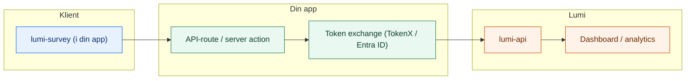

# Lumi


Lumi er et surveyverktøy for team i Nav. Surveyen vises i teamets egen React-app med `@navikt/lumi-survey`, og svarene lagres i Lumis database på Nais.

| Pakke | Beskrivelse | Teknologi |
| :--- | :--- | :--- |
| [`@navikt/lumi-survey`](packages/lumi-survey) | Widgeten som viser surveyen i appen (Aksel) | React, CSS Modules |
| [`lumi-api`](apps/lumi-api) | API for innsending og analyse | Kotlin, Ktor, Postgres |
| [`lumi-dashboard`](apps/lumi-dashboard) | Dashboardet og Surveyverksted | TanStack Start, React |

## Arkitektur



## Dokumentasjon

Dokumentasjonen for team som vil ta Lumi i bruk, ligger på [navikt.github.io/lumi](https://navikt.github.io/lumi/).

### Hurtigstart

```bash
pnpm add @navikt/lumi-survey
# eller
npm install @navikt/lumi-survey
# eller
yarn add @navikt/lumi-survey
```

Resten av oppsettet står i [Kom i gang](https://navikt.github.io/lumi/kom-i-gang/hva-er-lumi).

## Utvikling

Repoet bruker [mise](https://mise.jdx.dev/) til å holde Node og Java på samme versjon for alle. Pnpm-versjonen kommer fra `packageManager` i `package.json` via Corepack. Kjør `mise trust`, `mise install` og deretter `mise run setup` første gang du kloner repoet. Bruk `mise tasks` for å se oppdaterte utviklings-, test- og byggoppgaver.

### Lokal full-chain-demo

Oppgaven `local-up` starter Postgres, API, submission-proxy, dashboard og en ekte `@navikt/lumi-survey`-testside.

Åpne deretter:

- testbenk: <http://localhost:3001>
- dashboard med ekte lokale data: <http://localhost:3000>

Se [den lokale testguiden](scripts/README.md#full-chain-demo-med-ekte-widget) for variantmatrise, feilsøking og teardown.

## For Nav-ansatte

Spørsmål om utvikling og drift kan tas i [#lumi på Slack](https://nav-it.slack.com/archives/C0AG2FKSSMD).
