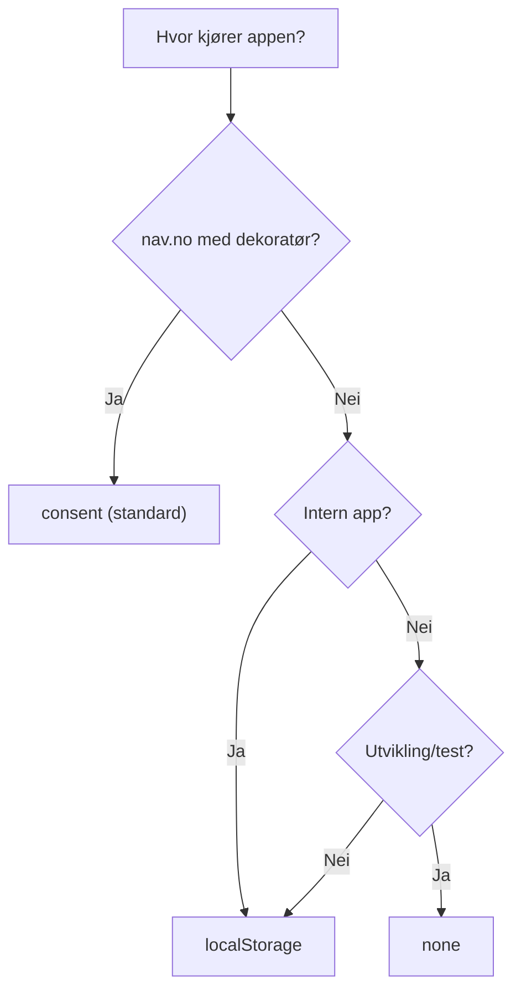

# Lagring

Widgeten husker at brukeren har lukket surveyen, og kan vente en stund før den viser surveyen igjen. Med `storageStrategy` velger dere hvordan widgeten husker dette.

## Strategier

| Strategi | App | Avhengigheter | Merknad |
| :--- | :--- | :--- | :--- |
| `consent` (standard) | Apper for sluttbrukere (nav.no) | Nav-dekoratøren og brukerens samtykke | Husker lukkingen bare når brukeren har samtykket |
| `localStorage` | Interne apper (Modia, fagsystemer) | Ingen | Lagrer direkte i `localStorage` |
| `none` | Alle | Ingen | Lagrer ingenting. Surveyen vises hver gang |

## `consent` (standard) {#consent}

Dette er standardstrategien, og den er laget for apper på nav.no. Widgeten lagrer lukkingen i `localStorage` under nøkkelen `lumi-dismissed-<surveyId>`, men bare når alt dette stemmer:

- Nav-dekoratøren er lastet, slik at `window.__DECORATOR_DATA__` og `window.webStorageController` finnes
- brukeren har samtykket til `surveys` i samtykkeløsningen til dekoratøren
- dekoratøren tillater nøkkelen `lumi-dismissed-<surveyId>`

Dere trenger ingen ekstra npm-pakke.

```tsx
<LumiSurveyDock
  surveyId="min-app-tilbakemelding"
  survey={survey}
  transport={transport}
  // consent er standard og trenger ikke settes
/>
```

### Uten samtykke {#uten-samtykke}

Mangler ett av punktene over, lagrer ikke widgeten noe. Den husker da ikke at brukeren har lukket surveyen, heller ikke etter at brukeren har sendt inn svar. Med `initialOpen: true`, som er standard, åpner surveyen seg igjen ved hver sidelast.

Vil dere ikke at surveyen skal åpne seg av seg selv for disse brukerne, kan dere sette `initialOpen: false`. Da viser widgeten den minimerte knappen til alle brukere, og brukeren åpner surveyen selv.

Slik sjekker dere samtykket i konsollen i DevTools på siden. Bytt ut `min-app-tilbakemelding` med `surveyId`-en deres:

```js
window.webStorageController.getCurrentConsent().consent.surveys;
window.webStorageController.isStorageKeyAllowed("lumi-dismissed-min-app-tilbakemelding");
```

Begge må gi `true`. Gir den siste `false`, tillater ikke dekoratøren nøkkelen. Spør da i [#lumi på Slack](https://nav-it.slack.com/archives/C0AG2FKSSMD).

Når appen kjører i utviklingsmodus, skriver widgeten også meldinger som begynner med `[Lumi]` i konsollen, for eksempel når samtykket mangler.

### Når dekoratøren lastes etter widgeten

Widgeten venter høyst 300 ms på å lese samtykket før den viser surveyen ut fra `initialOpen`. Oppslaget fortsetter i bakgrunnen i opptil fem sekunder. Blir dekoratøren klar i den tiden, bruker widgeten en lagret lukking så lenge brukeren ikke allerede har gjort noe i surveyen.

## `localStorage`

Bruk `localStorage` i interne apper uten Nav-dekoratøren, for eksempel Modia og fagsystemer:

```tsx
<LumiSurveyDock
  surveyId="modia-tilbakemelding"
  survey={survey}
  transport={transport}
  behavior={{ storageStrategy: "localStorage" }}
/>
```

Widgeten lagrer at surveyen er lukket i `localStorage`, under nøkkelen `lumi-dismissed-<surveyId>`.

## `none`

Widgeten lagrer ingenting, og surveyen vises ved hver sidelast. Det er nyttig under utvikling og i engangstilfeller:

```tsx
<LumiSurveyDock
  surveyId="test-survey"
  survey={survey}
  transport={transport}
  behavior={{ storageStrategy: "none" }}
/>
```

## Ventetid

Etter at brukeren har lukket surveyen, venter widgeten som standard 30 dager før den viser den igjen. Ventetiden setter dere med `dismissCooldownDays`:

```tsx
<LumiSurveyDock
  surveyId="min-app-tilbakemelding"
  survey={survey}
  transport={transport}
  behavior={{
    storageStrategy: "localStorage",
    dismissCooldownDays: 7, // Vis igjen etter 7 dager
  }}
/>
```

| Felt | Type | Standard | Beskrivelse |
| :--- | :--- | :--- | :--- |
| `storageStrategy` | `"consent" \| "localStorage" \| "none"` | `"consent"` | Hvordan widgeten husker at surveyen er lukket |
| `dismissCooldownDays` | `number` | `30` | Antall dager før surveyen vises igjen etter at den er lukket. `0` betyr at lukkingen ikke utløper |
| `hideAfterSubmit` | `boolean` | `true` | Skjul widgeten helt etter vellykket innsending |

## Velg riktig strategi



::: danger Vanlig feil i interne apper
Standard er `consent`. Uten Nav-dekoratøren kan ikke widgeten huske at brukeren lukket surveyen, og surveyen åpner seg igjen ved hver sidelast. Sett `storageStrategy: "localStorage"` i alle interne apper:

```tsx
<LumiSurveyDock behavior={{ storageStrategy: "localStorage" }} />
```
:::

## Events ved lagringsfeil

Hvis lagringen feiler, for eksempel fordi brukeren ikke har samtykket, kaller widgeten `onDismissalPersistFailed`. Se [Events](/referanse/events).

```tsx
<LumiSurveyDock
  events={{
    onDismissalPersistFailed: (cause) => {
      console.warn("Kunne ikke lagre at surveyen er lukket:", cause);
    },
  }}
/>
```
