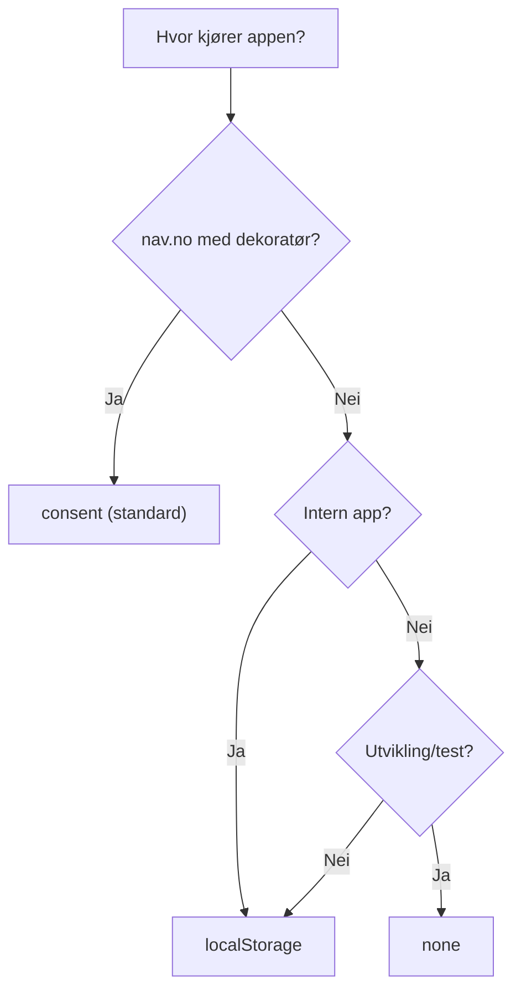

# Lagring

Widgeten husker at brukeren har lukket eller svart på surveyen, og kan vente en stund før den viser surveyen igjen. Med `storageStrategy` velger dere hvordan widgeten husker dette.

## Strategier

| Strategi | App | Avhengigheter | Merknad |
| :--- | :--- | :--- | :--- |
| `consent` (standard) | Apper for sluttbrukere (nav.no) | Nav-dekoratøren og brukerens samtykke | Husker lukking og svar bare når brukeren har samtykket. Uten samtykke starter widgeten minimert |
| `localStorage` | Interne apper (Modia, fagsystemer) | Ingen | Lagrer direkte i `localStorage` |
| `none` | Alle | Ingen | Lagrer ingenting. Surveyen vises hver gang |

## `consent` (standard) {#consent}

Dette er standardstrategien, og den er laget for apper på nav.no. Widgeten lagrer lukkingen i `localStorage` under nøkkelen `lumi-dismissed-<surveyId>`, men bare når alt dette stemmer:

- Nav-dekoratøren er lastet, slik at `window.__DECORATOR_DATA__` og `window.webStorageController` finnes
- brukeren har samtykket til `surveys` i samtykkeløsningen til dekoratøren
- dekoratøren tillater nøkkelen `lumi-dismissed-<surveyId>`

Dere trenger ingen ekstra npm-pakke.

```tsx
<LumiSurveyDock
  surveyId="min-app-tilbakemelding"
  survey={survey}
  transport={transport}
  // consent er standard og trenger ikke settes
/>
```

### Uten samtykke {#uten-samtykke}

Mangler ett av punktene over, får ikke widgeten lagre noe. Da starter den minimert, også med `initialOpen: true`, som er standard. Brukeren ser knappen **Gi tilbakemelding** og åpner surveyen selv. Widgeten husker ikke at brukeren har lukket eller svart på surveyen, så knappen vises igjen ved neste sidelast.

Det samme gjelder interne apper uten Nav-dekoratøren. Sett `storageStrategy: "localStorage"` der, så åpner surveyen seg av seg selv og widgeten husker lukkingen. Se [`localStorage`](#localstorage).

Slik virker det fra versjon 2.3.0 av `@navikt/lumi-survey`. I eldre versjoner åpner surveyen seg ved hver sidelast for brukere uten samtykke.

Slik sjekker dere samtykket i konsollen i DevTools på siden. Bytt ut `min-app-tilbakemelding` med `surveyId`-en deres:

```js
window.webStorageController.getCurrentConsent().consent.surveys;
window.webStorageController.isStorageKeyAllowed("lumi-dismissed-min-app-tilbakemelding");
```

Begge må gi `true`. Gir den siste `false`, tillater ikke dekoratøren nøkkelen. Spør da i [#lumi på Slack](https://nav-it.slack.com/archives/C0AG2FKSSMD).

Er oppsettet feil, skriver widgeten en advarsel som begynner med `[Lumi]` i konsollen, én gang per sidelast og også i produksjon. Bruker appen Faro, fanger Faro `console.warn`, og en feilkonfigurert app får én logglinje per sidelast. Advarselen sier hva dere bør gjøre:

- Finner ikke widgeten dekoratøren, ber den dere sette `storageStrategy: "localStorage"`.
- Tillater ikke dekoratøren nøkkelen selv om brukeren har samtykket, ber den dere spørre i [#lumi på Slack](https://nav-it.slack.com/archives/C0AG2FKSSMD).

Har brukeren bare takket nei, kommer det ingen advarsel. I utviklingsmodus skriver widgeten flere `[Lumi]`-meldinger, for eksempel når samtykket mangler.

### Når dekoratøren lastes etter widgeten

Widgeten venter høyst 300 ms på å lese samtykket. Har den ikke fått svar da, vises den minimerte knappen **Gi tilbakemelding**. Oppslaget fortsetter i bakgrunnen i opptil fem sekunder. Så lenge brukeren ikke har gjort noe i widgeten, bruker den svaret når det kommer:

- Har brukeren samtykket og ingenting er lagret, åpner surveyen seg ut fra `initialOpen`.
- Finnes det en lagret lukking eller et lagret svar, blir surveyen skjult eller værende minimert.
- Mangler samtykket, eller finner ikke widgeten dekoratøren innen fem sekunder, blir surveyen værende minimert.

## `localStorage`

Bruk `localStorage` i interne apper uten Nav-dekoratøren, for eksempel Modia og fagsystemer:

```tsx
<LumiSurveyDock
  surveyId="modia-tilbakemelding"
  survey={survey}
  transport={transport}
  behavior={{ storageStrategy: "localStorage" }}
/>
```

Widgeten lagrer at surveyen er lukket eller besvart i `localStorage`, under nøkkelen `lumi-dismissed-<surveyId>`.

## `none`

Widgeten lagrer ingenting, og surveyen vises ved hver sidelast. Det er nyttig under utvikling og i engangstilfeller:

```tsx
<LumiSurveyDock
  surveyId="test-survey"
  survey={survey}
  transport={transport}
  behavior={{ storageStrategy: "none" }}
/>
```

## Ventetid

Etter at brukeren har lukket eller svart på surveyen, venter widgeten som standard 30 dager før den viser den igjen. Svaret lagres så snart innsendingen er vellykket, også når brukeren går videre uten å trykke **Lukk** på kvitteringen. Med `hideAfterSubmit: true`, som er standard, er widgeten helt skjult i ventetiden etter et svar. Med `hideAfterSubmit: false` vises den minimerte knappen.

Ventetiden setter dere med `dismissCooldownDays`:

```tsx
<LumiSurveyDock
  surveyId="min-app-tilbakemelding"
  survey={survey}
  transport={transport}
  behavior={{
    storageStrategy: "localStorage",
    dismissCooldownDays: 7, // Vis igjen etter 7 dager
  }}
/>
```

| Felt | Type | Standard | Beskrivelse |
| :--- | :--- | :--- | :--- |
| `storageStrategy` | `"consent" \| "localStorage" \| "none"` | `"consent"` | Hvordan widgeten husker at surveyen er lukket eller besvart |
| `dismissCooldownDays` | `number` | `30` | Antall dager før surveyen vises igjen etter at den er lukket eller besvart. `0` betyr at ventetiden aldri går ut |
| `hideAfterSubmit` | `boolean` | `true` | Skjul widgeten helt etter vellykket innsending, til ventetiden er over |

## Velg riktig strategi



::: danger Vanlig feil i interne apper
Standard er `consent`. Uten Nav-dekoratøren får ikke widgeten lagre noe, og den starter minimert ved hver sidelast. Brukerne må da åpne surveyen selv. Sett `storageStrategy: "localStorage"` i alle interne apper, så åpner surveyen seg av seg selv og widgeten husker lukkingen:

```tsx
<LumiSurveyDock behavior={{ storageStrategy: "localStorage" }} />
```
:::

## Events ved lagringsfeil

Hvis lagringen feiler, for eksempel fordi brukeren ikke har samtykket, kaller widgeten `onDismissalPersistFailed`. Se [Events](/referanse/events).

```tsx
<LumiSurveyDock
  events={{
    onDismissalPersistFailed: (cause) => {
      console.warn("Kunne ikke lagre at surveyen er lukket:", cause);
    },
  }}
/>
```
